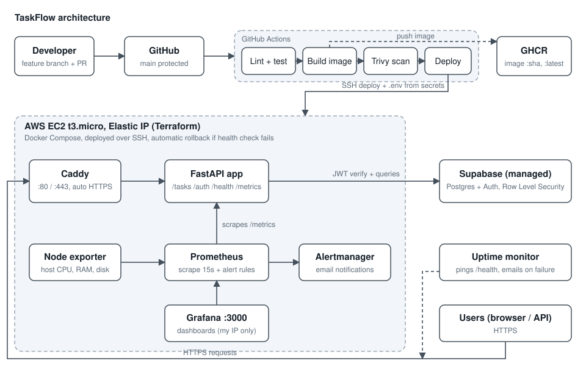

# TaskFlow

A task-tracker REST API with a small web UI, built as a DevOps capstone: containerized, tested and deployed automatically, and monitored in production.

**Live app:** https://YOUR-DOMAIN  |  **Grafana:** http://YOUR-IP:3000  |  **API docs:** https://YOUR-DOMAIN/docs



## What is in the stack

| Concern | Tool |
|---|---|
| App | FastAPI (Python 3.12) and a static HTML/JS front end |
| Managed database and auth | Supabase (Postgres, JWT auth, Row Level Security) |
| Source control | Git and GitHub, protected `main`, pull requests |
| Containers | Multi-stage Dockerfile (non-root user, healthcheck) and Docker Compose |
| CI/CD | GitHub Actions: lint, test, build, Trivy scan, push to GHCR, SSH deploy, auto-rollback |
| Infrastructure as code | Terraform: EC2, Elastic IP, security group, key pair |
| HTTPS | Caddy with automatic certificates |
| Monitoring | Prometheus, Grafana (provisioned dashboard), Alertmanager, node exporter, external uptime check |

## API

| Method | Path | Auth | Purpose |
|---|---|---|---|
| POST | `/auth/signup`, `/auth/login` | no | Returns `{access_token}` |
| GET / POST | `/tasks` | Bearer | List or create your tasks |
| PATCH / DELETE | `/tasks/{id}` | Bearer | Update or delete a task |
| GET | `/health` | no | Liveness check |
| GET | `/metrics` | no | Prometheus metrics |

Each user only sees their own rows. This is enforced twice: the API filters by `user_id`, and Postgres Row Level Security applies the user's JWT.

## Run it locally

```bash
python -m venv .venv && source .venv/bin/activate
pip install -r requirements-dev.txt
cp .env.example .env        # fill in SUPABASE_URL and SUPABASE_KEY
set -a; source .env; set +a
make test                   # 8 tests, Supabase is faked
make dev                    # http://localhost:8000
```

Full stack with Docker (app, Caddy, Prometheus, Grafana, Alertmanager):

```bash
docker compose up -d --build     # app on https://localhost, Grafana on :3000
```

## Setup from zero

### 1. Supabase
1. Create a free project at supabase.com.
2. Open **SQL Editor**, paste `supabase/schema.sql` and run it.
3. For a simple demo, go to **Authentication, Providers, Email** and turn off "Confirm email".
4. Copy the **Project URL** and the **anon public** key from Settings, API.

### 2. Infrastructure (Terraform)
```bash
aws configure                                   # IAM user with EC2 permissions
cd infra/terraform
terraform init
terraform apply -var 'my_ip=YOUR.IP.ADDRESS/32' # find it with: curl ifconfig.me
```
Terraform prints `public_ip` and `domain_nip_io`. If you have no domain, use the nip.io name; Caddy will obtain a real certificate for it. To make a free domain stable, point a DuckDNS or your own DNS record at the Elastic IP.

### 3. GitHub
Create the repo, push this code, then add **Settings, Secrets and variables, Actions, Secrets**:

| Secret | Value |
|---|---|
| `EC2_HOST` | Elastic IP from Terraform |
| `EC2_SSH_KEY` | Contents of the private key that matches `public_key_path` |
| `SUPABASE_URL` / `SUPABASE_KEY` | From step 1 |
| `GRAFANA_PASSWORD` | Any strong password |
| `DOMAIN` | e.g. `13-233-10-5.nip.io` or your own domain |

Also create an **Environment** named `production` (Settings, Environments). Optionally require a reviewer there for manual approval.

Then protect `main`: Settings, Branches, require a pull request and the `test` status check.

### 4. Ship it
Edit `monitoring/alertmanager.yml` with your SMTP details, then push a feature branch, open a PR, and merge. The pipeline runs by itself.

```
PR:    lint + test
main:  lint + test -> build -> Trivy scan -> push :sha and :latest to GHCR
       -> copy compose/monitoring files -> SSH deploy -> health check
       -> if unhealthy, restore the previous image tag automatically
```

**Manual rollback:** Actions, CI/CD, Run workflow, set `rollback_tag` to an earlier commit SHA.

### 5. Monitoring
- Grafana: `http://YOUR-IP:3000` (user `admin`, your `GRAFANA_PASSWORD`). The **TaskFlow overview** dashboard is provisioned automatically: status, request rate, p95 latency, 5xx ratio, host CPU and memory.
- Alert rules are in `monitoring/alerts.yml`: AppDown, HighErrorRate, SlowRequests, HighMemory, DiskAlmostFull. View them at `http://localhost:9090/alerts` through an SSH tunnel: `ssh -L 9090:localhost:9090 ubuntu@IP` (add `ports: ["127.0.0.1:9090:9090"]` to the Prometheus service if you want this).
- External check: create a free UptimeRobot or Better Stack HTTP monitor on `https://YOUR-DOMAIN/health` with email alerts.

**Prove it works (for your report):**
```bash
ssh ubuntu@IP "cd ~/taskflow && docker compose stop app"   # AppDown fires after ~1 minute
ssh ubuntu@IP "cd ~/taskflow && docker compose start app"  # alert resolves
```
Take screenshots of the firing alert, the email, and the Grafana dashboard.

## Repository layout

```
app/                FastAPI code, static UI
tests/              pytest suite (Supabase replaced by an in-memory fake)
supabase/schema.sql Table and RLS policies
Dockerfile          Multi-stage, non-root
docker-compose.yml  App, Caddy, Prometheus, Alertmanager, Grafana, node exporter
monitoring/         Prometheus, alert rules, Alertmanager, Grafana provisioning
infra/terraform/    AWS infrastructure
.github/workflows/  CI/CD pipeline
docs/               Architecture diagram
```

## Design decisions
- **Supabase** for the database and auth so the project focuses on delivery, not on running Postgres. Row Level Security keeps tenant isolation in the database itself.
- **Single EC2 instance with Compose** is cheap and easy to explain. The trade-off is no high availability; moving to ECS or Kubernetes is the next step.
- **Immutable image tags** (commit SHA) make every deploy traceable and every rollback a one-line change.
- **Secrets** live only in GitHub Secrets; `.env` is written on the server during deploy and never committed.
- **Network exposure:** only 80/443 are public. SSH and Grafana are limited to your IP by the security group.

## Challenges and lessons learned
_Fill this in with your own experience (for example: a failed deploy you debugged, memory limits on a 1 GB instance, certificate issuance delays). Graders value this section._
